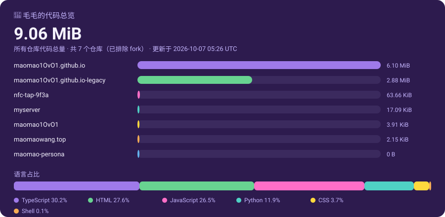
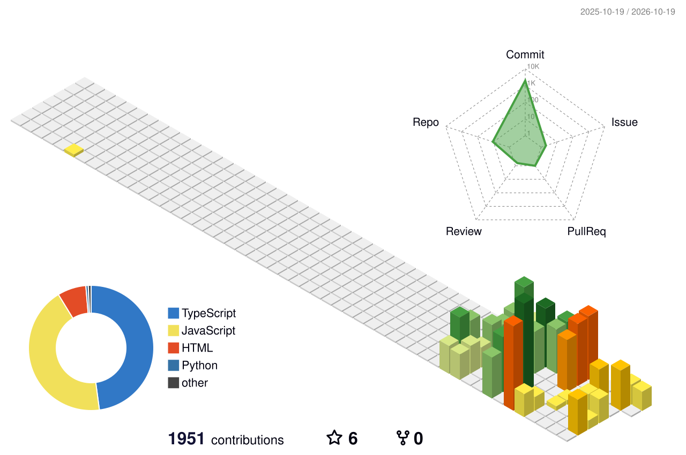

<!-- ═══ 第一屏：横幅 + 名字 + 技术定位 ═══ -->

 

---

## 🧭 简介

**全栈开发（偏前端），从设计、编码到部署运维，全部独立完成。**

- **方向**：Web 交互与图形渲染（Canvas 2D / 3D）、小游戏、在线工具、Node 服务、Android 自动化
- **技术偏好**：零依赖优先、纯前端可离线、静态优先部署；能自己实现就不套模板
- **工作环境**：Android 手机 + Termux + DSH，编码 / 构建 / 部署 / 运维全流程在移动端完成
- **关注点**：渲染性能、交互手感、移动端适配

## 🚀 项目

| 项目 | 技术要点 | 入口 |
|---|---|---|
| **个人小站** | 静态站点 + 单页导航；游戏 / 音乐 / 相册三个子站 | [在线](https://maomao1ovo1.github.io) · [源码](https://github.com/maomao1OvO1/maomao1OvO1.github.io) |
| **共鸣之塔** | 像素塔防：元素共鸣、8 座塔、无尽模式；Canvas 逐帧渲染 | [在线](https://maomao1ovo1.github.io/games/td/source/game.html) · [源码](https://github.com/maomao1OvO1/maomao1OvO1.github.io) |
| **小游戏大厅** | 8 款小游戏（2048 / 贪吃蛇 / 打字 / 猜数字 / 五子棋 / 象棋 / 捕鱼 / 围棋）+ 在线排行榜 | [在线](https://maomao1ovo1.github.io/games.html) |
| **ToolPocket 工具袋** | 35 个纯前端工具，文件不上传、无需注册；中 / 英 / 日三语 | [在线](https://tools.maomaowang.top/) · [源码](https://github.com/maomao1OvO1/baigong) |
| **CoverMill** | 纯前端 Canvas 批量出图：20 套模板 × 6 种平台尺寸，ZIP 打包导出 | [在线](https://maomaowang.top/covermill/) · [源码](https://github.com/maomao1OvO1/covermill) |
| **NFC 一贴就听** | NFC 标签触发网页 + HLS 音频流播放 | [在线](https://maomao1ovo1.github.io/nfc-tap-9f3a/) · [源码](https://github.com/maomao1OvO1/nfc-tap-9f3a) |
| **太阳系 3D** | 3D 星球模型与轨道交互 | [在线](https://maomao1ovo1.github.io/solar-system/) |
| **硬件测试大厅** | 指纹 / 传感器免授权检测，逐项权限申请 | [在线](https://maomao1ovo1.github.io/hardware-lab/) |
| **JS 渲染演示** | 单文件零依赖：HTML 只留一个空 `
`，页面元素全部由 JS 构建 | [在线](https://maomao1ovo1.github.io/render.html) |
| **磁力认知小游戏** | 面向低龄用户的磁力交互演示 | [源码](https://github.com/maomao1OvO1/magnet-miner) |
| **排行榜服务** | 零依赖 Node.js：上报分数 → 维护全球榜 → `/ranking` 查询；内置限流防刷 | [源码](https://github.com/maomao1OvO1/myserver) |
| **日语学习平台** | 极简界面 + 假名练习流程 | [源码](https://github.com/maomao1OvO1/kana-dojo) |

## 🏗 工程实践

- **CI / 自动化**：GitHub Actions 每日重建仓库代码统计与图表；提交自动部署 GitHub Pages
- **部署**：静态站 → GitHub Pages；边缘服务 → Cloudflare Workers；实时数据 → 自建 Node 服务
- **零依赖与隐私**：多个工具设计为单文件、零依赖、可离线运行，不上传文件、不采集数据
- **移动端开发环境**：Android + Termux（bash / git / node / pnpm / ffmpeg）+ ADB / Shizuku 脚本化运维
- **AI 辅助工程**：使用 DeepSeek Harness（DSH）完成代码生成、排障与配置管理，并维护自建插件体系

<!-- 技术栈 -->

常用技术栈 —— 最后两枚是开发工具链：DeepSeek（模型）+ DeepSeek Harness（运行壳）

<b>🔧 点开看完整技术栈</b>

 

工具链：Termux · ffmpeg · ADB · TTS · GitHub Pages

## 📊 数据

<!-- 代码总览图：由 .github/workflows/code-stats.yml 每天自动重新生成
     —— 数字 + 各仓库条形 + 语言占比都在一张图里，一眼能看出大小差距 -->

 

<b>📈 点开看更多数据</b>（贡献热力条 · 总览 · 项目卡 · 各种徽章）

 

 

---

**保持好奇 · 持续构建**

作品均为个人独立开发 · 部分项目开源，源码见上表

  

## 🤖 给 AI 的一句话（换机 · 恢复自己）

如果我在**新设备**上对你说「恢复自己」「用 GitHub 上的备份恢复」，照这个来：

1. 用我给你的 GitHub 令牌调 `GET /user/repos?per_page=100`；
2. 找到 **description 里含「DSH 配置恢复包」** 的那个**私有仓库**（名字不用我记）；
3. 读它的 `DSH配置备份/AI恢复指引.md`，按指引执行 `restore.sh` —— 脚本会自己下载清单、校验 SHA-256、备份旧配置、解包（配置 + 插件 + 项目文档）并自检；
4. 做完告诉我：**恢复了什么、还差什么**（DeepSeek key / GitHub 令牌 / 会话历史 / 代理节点 / 手机系统授权 / 要重启 DSH）。

> 一句话记法：**「用我 GitHub 上的备份恢复自己」** —— 剩下的交给 AI。
